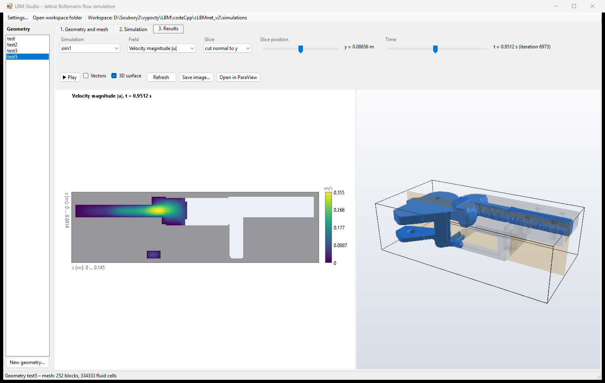
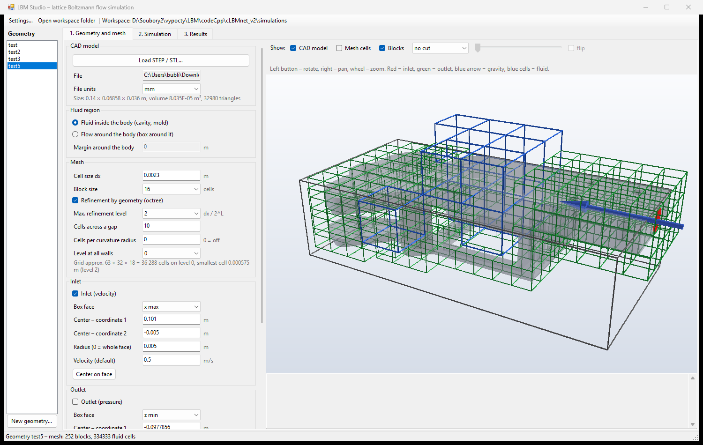
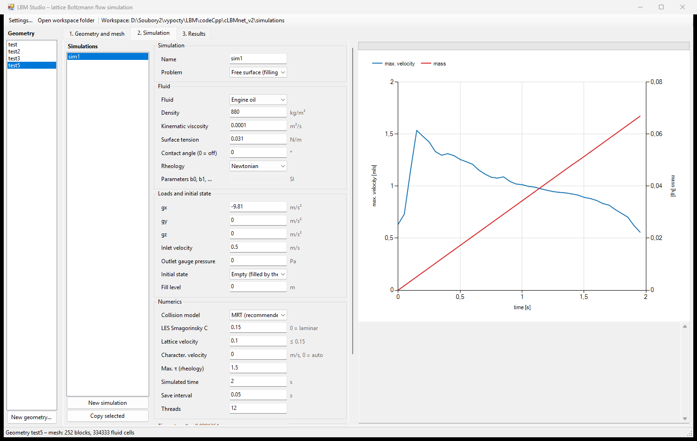

# LBM4U

```
L       BBBBB   MM    MM     44   U     U
L       B    B  M M  M M    4 4   U     U
L       BBBBB   M  MM  M   4  4   U     U
L       B    B  M      M  444444  U     U
LLLLLL  BBBBB   M      M      4    UUUUU
```

**LBM4U** is a 3D lattice Boltzmann (LBM) fluid flow solver in C++ with OpenMP, focused on **mold filling with a free surface**. It comes with **LBM Studio**, a graphical interface that takes you through the whole workflow: from a CAD model (STEP / STL) to the computational mesh, the simulation setup and the results.



## Features

**Solver (`cLBMnet`)**

* D3Q19, D3Q15 and D2Q9 lattices, block-structured mesh parallelized with OpenMP.
* **BGK, TRT and MRT** collision operators, Smagorinsky **LES** model, Guo forcing.
* **Free surface** (VOF / mass tracking after Thürey): mass exchange between interface cells, excess mass redistribution, surface tension and contact angle.
* **Non-Newtonian fluids**: power-law, Bingham, Cross, polynomial; shear rate from the non-equilibrium moments.
* Boundary conditions: bounce-back wall, velocity inlet, pressure outlet (anti-bounce-back), moving wall.
* **Static octree grid refinement** driven by the geometry: 2:1 balancing, sub-cycling of the fine levels, volumetric level interface (Rohde et al.), mass conserved to machine precision – including the free surface.
* Particles and fibers: Lagrangian particles, fibers and an Eulerian concentration model (FVM / LBM).
* **VTK XML** output (`.vtu`, `.vtp`, `.pvd`) with zlib compression – opens directly in ParaView, plus compact `fields_<iter>.bin` files for the GUI.
* Optional single precision populations (`-DLBM_FP32=ON`) – half the memory.

**Graphical interface (LBM Studio)**

* STL and STEP import (conversion via gmsh or FreeCAD), 3D model preview.
* Mesh generation including octree refinement by the narrowest gaps and the surface curvature.
* Inlet and outlet placed graphically on a face of the bounding box.
* Fluid presets, rheology models, derived quantities (dt, τ, Mach number, memory) with warnings.
* Run and stop the solver, live chart of the maximum velocity and the fluid mass.
* Slices along any axis (|u|, velocity components, pressure, VOF, cell state), vectors, time line with playback, 3D free surface, opening in ParaView.

## LBM Studio – example

Case `test5`: filling of a mold cavity with engine oil, octree mesh with 3 levels (252 blocks, 334 333 fluid cells).

**1. Geometry and mesh** – CAD model, inlet (red), gravity (blue arrow) and mesh blocks colored by the refinement level.



**2. Simulation** – fluid, loads, numerics and the progress of the computation.



**3. Results** – velocity slice and 3D shape of the free surface at t ≈ 0.95 s.


## Building

Requirements: CMake ≥ 3.16, a C++17 compiler with OpenMP (Visual Studio 2022 or MSYS2 MinGW g++). The GUI needs .NET Framework 4.8 (C# compiler of Visual Studio) or the .NET SDK.

```bat
build.bat            :: Visual Studio 2022 (MSVC, OpenMP /openmp:llvm)
build.bat mingw      :: MSYS2 g++ + Ninja, statically linked exe
gui\build_gui.bat    :: LBM Studio -> gui\bin\LBMStudio.exe
```

On Linux or manually:

```bash
cmake -S . -B build -DCMAKE_BUILD_TYPE=Release   # optionally -DLBM_FP32=ON
cmake --build build
```

This builds the solver `cLBMnet` and the unit tests `lbm_tests`.

## Running the solver

The easiest way is LBM Studio, which prepares the mesh and the parameters and runs the solver itself. From the command line:

```bat
cLBMnet                                :: reads "geometry simulation" from args.txt
cLBMnet <geometry> <simulation>        :: simulations/<geometry>/<simulation>/
cLBMnet --paths <geometryDir> <simulationDir>
```

Case layout:

```
simulations/
└── <geometry>/
    ├── geometry.ini, geometry.stl     # geometry definition (GUI)
    ├── mesh/                          # blocks.txt, boundary/*.txt, celltypes.bin, octree.bin
    └── <simulation>/
        ├── parameters.txt             # solver parameters
        ├── init/                      # initial state
        └── result/                    # output.pvd, outputFS.pvd, *.vtu, *.vtp, fields_<iter>.bin
```

* A run can be stopped early by creating a file named `STOP` in the simulation directory – the results are saved.
* Exit code 3 means divergence (NaN).
* Open the results in ParaView via `result/output.pvd` (volume) and `result/outputFS.pvd` (free surface).

## Tests

```bat
cd build-msvc\Release
lbm_tests.exe              :: all tests
lbm_tests.exe refinement   :: only tests whose name contains "refinement"
```

The tests cover the collision operators, Poiseuille flow (TRT/MRT accuracy), the free surface (mass conservation, dam break, fluid at rest) and the grid refinement.

The GUI has an automatic test of the whole chain (import, mesh, simulation, results, screenshots):

```bat
gui\bin\LBMStudio.exe --selftest <file.stl|step> <output dir> [cLBMnet.exe] [--refine]
```

## Repository layout

| Path | Contents |
|---|---|
| `main.cpp` | main loop of the solver |
| `Mesh.*` | block mesh, octree, exchange between blocks, output |
| `Block*.*` | blocks: single phase flow, free surface, particles and fibers |
| `Collision.*` | BGK / TRT / MRT collision operators, LES |
| `Lagrange*.*`, `MarchingCubes.*` | particles, fibers, free surface reconstruction |
| `Deflate.*` | own compressor for VTK and `fields_*.bin` (no zlib dependency) |
| `tests/` | unit tests |
| `gui/` | LBM Studio (C#, WinForms + WPF 3D) – [description](gui/README.md) |
| `matlab/` | older MATLAB scripts for case preparation |
| `ZMENY.md` | [change log](ZMENY.md) (in Czech): numerical details and the `fields_<iter>.bin` format |

## Authors

* Ondřej Bublík
* Václav Heidler
